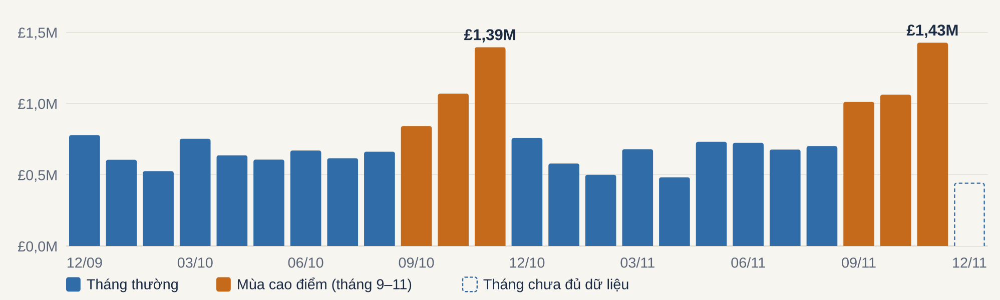
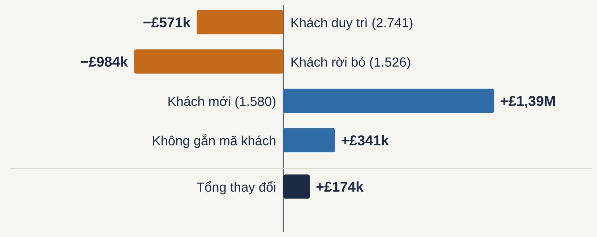
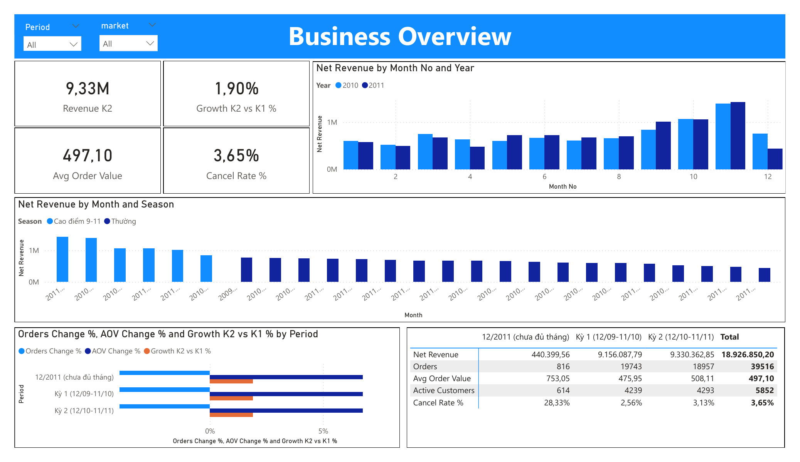
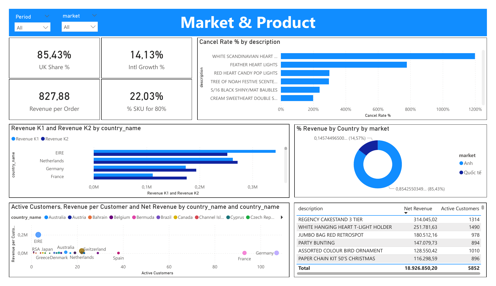
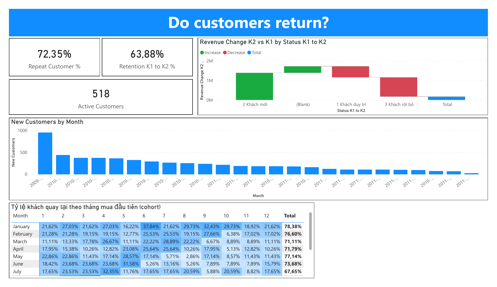
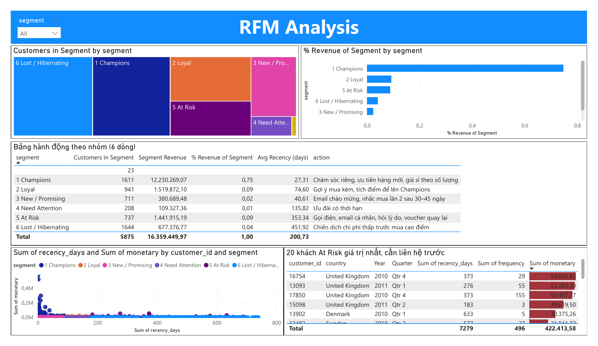
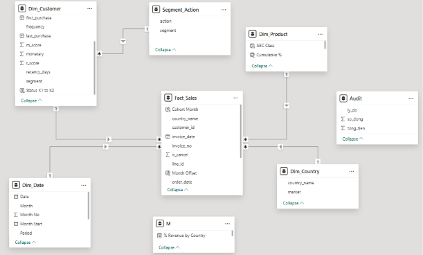

# Phân tích kinh doanh & khách hàng – Online Retail II

**SQL (MySQL 8) · Phân tích cohort · Phân nhóm RFM · Dashboard Power BI**

Phân tích hơn 1 triệu dòng giao dịch của một cửa hàng bán lẻ trực tuyến ở Anh (12/2009 – 12/2011) để trả lời câu hỏi của Ban giám đốc: *hai năm qua kinh doanh ra sao, khách hàng là ai, năm tới nên tập trung vào đâu?* Toàn bộ làm sạch, tính toán và kiểm chứng được thực hiện bằng SQL. Power BI chỉ dùng để trình bày.

### Kết quả nổi bật

- **Doanh thu đi ngang:** £9,33M trong 12 tháng gần nhất, chỉ **+1,9%** so với 12 tháng trước. **37,5%** doanh thu năm dồn vào tháng 9–11.
- **Tăng trưởng đến từ quốc tế:** Anh chiếm 85,4% doanh thu nhưng **−0,1%**; quốc tế **+14,1%**.
- **Khách cũ chi ít đi, khách mới giảm:** khách duy trì chi ít hơn £571k, khách rời bỏ làm mất £984k. Khách mới (tháng 7–11) giảm **37%** so với cùng kỳ.
- **Khách trung thành là xương sống:** 72,4% khách mua từ 2 lần. Nhóm Champions chiếm 27,5% số khách nhưng tạo **74,8%** doanh thu. Nhóm At Risk gồm **737 khách, £1,44M**, cần kéo lại.

---

## 1. Bối cảnh

Công ty bán lẻ trực tuyến tại Anh, chuyên quà tặng và đồ trang trí. Khách hàng gồm khách lẻ và nhiều cửa hàng nhỏ mua sỉ. Dự án đóng vai Data Analyst, trả lời 3 nhóm câu hỏi:

1. **Dữ liệu:** có những vấn đề gì, xử lý thế nào, lựa chọn đó ảnh hưởng đến kết quả ra sao?
2. **Kinh doanh:** doanh thu biến động thế nào, đến từ thị trường và sản phẩm nào, có điều gì đáng lo?
3. **Khách hàng:** khách có quay lại không, nên chia thành những nhóm nào và làm gì với từng nhóm?

## 2. Dữ liệu

Nguồn: Chen, D. *Online Retail II*. [UCI Machine Learning Repository](https://archive.ics.uci.edu/dataset/502/online+retail+ii) (CC BY 4.0). Dữ liệu được tổ chức thành 5 bảng quan hệ trong MySQL:

| Bảng | Số dòng | Một dòng là |
|---|---:|---|
| `countries` | 43 | một quốc gia |
| `customers` | 5.942 | một khách có mã |
| `products` | 5.305 | một mã hàng |
| `invoices` | 53.628 | một hóa đơn |
| `invoice_lines` | 1.044.848 | một dòng hàng trong hóa đơn |

Dữ liệu chưa làm sạch. Repo **không** chứa file dữ liệu, xem mục [Cách chạy lại](#9-cách-chạy-lại).

## 3. Cấu trúc repo

```
online-retail-sql-analysis/
├── README.md
├── sql/
│   ├── 00_setup_check.sql          kiểm tra dữ liệu đã nạp đủ
│   ├── 01_data_profiling.sql       khám phá chất lượng dữ liệu
│   ├── 02_data_cleaning.sql        làm sạch: line_audit, sales_clean
│   ├── 03_validation.sql           kiểm chứng số liệu
│   ├── 04_business_analysis.sql    doanh thu, thị trường, sản phẩm
│   ├── 05_customer_retention.sql   mua lại, giữ chân, cohort
│   ├── 06_rfm_segmentation.sql     bảng đặc trưng khách hàng + RFM
│   ├── 07_extra_questions.sql      cầu doanh thu, thời gian mua lần 2
│   ├── 08_key_metrics.sql          bảng số liệu chính
│   ├── 09_powerbi_views.sql        5 view làm nguồn cho Power BI
│   └── run_all.sql                 chạy 00 → 08 một lần
├── output/
│   ├── customer_features.csv       bảng đặc trưng khách hàng (5.852 khách)
│   └── query_results.txt           kết quả chạy toàn bộ truy vấn
├── slides/presentation.pdf         báo cáo 8 trang cho Ban giám đốc
├── powerbi/
│   ├── online_retail_dashboard.pbit
│   └── online_retail_dashboard.pdf
└── images/                         biểu đồ và ảnh dashboard
```

## 4. Cách làm

### 4.1 Làm sạch: gắn nhãn, không xóa

Mỗi dòng hóa đơn được gắn nhãn "Giữ lại" hoặc lý do loại theo 5 quy tắc (bảng `line_audit`). Nhờ vậy đo được mỗi quy tắc loại bao nhiêu dòng và bao nhiêu tiền, và chứng minh được tổng các nhóm bằng dữ liệu gốc. Bảng gốc không bị sửa.

| Quy tắc | Số dòng | Tiền (£) |
|---|---:|---:|
| R1 – Hóa đơn điều chỉnh nợ xấu (mã `A`) | 6 | −147.614 |
| R2 – Mã không phải sản phẩm (`POST`, `M`, `AMAZONFEE`, `BANK CHARGES`…) | 5.825 | +76.078 |
| R3 – Đơn giá ≤ 0 (hàng tặng, hỏng, mất) | 5.973 | 0 |
| R4 – Hóa đơn bán nhưng số lượng ≤ 0 | 0 | 0 |
| R5 – Dòng trùng lặp hoàn toàn | 11.794 | +54.448 |
| **Giữ lại** (`sales_clean`) | **1.021.250 (97,7%)** | **18.926.850** |

Ba quyết định ảnh hưởng tới kết quả:

- **Giữ hóa đơn hủy (mã `C`) làm doanh thu âm** → chỉ số chính là **doanh thu thuần** = bán − hủy/trả. Hủy/trả bằng 3,65% doanh thu gộp. Ví dụ: một đơn 80.995 sản phẩm (£168k) bị hủy sau 12 phút. Bỏ dòng hủy sẽ thổi phồng doanh thu.
- **Giữ dòng thiếu mã khách** (13,6% doanh thu) khi tính doanh thu, chỉ loại khi phân tích khách hàng.
- **So sánh 2 kỳ 12 tháng đủ** (Kỳ 1 = 12/2009–11/2010, Kỳ 2 = 12/2010–11/2011), vì tháng 12/2011 chỉ có 9 ngày dữ liệu.

Ngoài ra, 173 cặp mã hàng chỉ khác chữ hoa/thường (161 cặp cùng mô tả) được gộp bằng `product_key = UPPER(stock_code)`.

### 4.2 Kiểm chứng

`03_validation.sql` trả về `OK` cho cả 4 kiểm tra:
- số dòng và tổng tiền của `line_audit` khớp bảng gốc;
- `sales_clean` khớp nhóm "Giữ lại";
- dữ liệu sạch không còn giá ≤ 0 hay dòng trùng;
- doanh thu thuần cộng theo tháng = theo quốc gia = tính trực tiếp (£18.926.850).

### 4.3 Phân tích

- **Kinh doanh:** doanh thu theo tháng, so sánh 2 kỳ, mùa vụ, thị trường, Pareto sản phẩm, tỷ lệ hủy, mức độ tập trung khách.
- **Khách hàng:** tỷ lệ mua lại, giữ chân giữa 2 kỳ, cohort theo tháng mua đầu tiên, phân nhóm **RFM** (R, F theo ngưỡng cố định để dễ giải thích; M theo `NTILE(5)`).
- **Kỹ thuật SQL dùng:** CTE, window function (`ROW_NUMBER`, `NTILE`, `SUM() OVER`), `CASE`, bảng trung gian `CREATE TABLE … AS`, index.

## 5. Kết quả: Kinh doanh



| Chỉ số | Kỳ 1 (12/09–11/10) | Kỳ 2 (12/10–11/11) | Thay đổi |
|---|---:|---:|---:|
| Doanh thu thuần | £9.156.088 | £9.330.363 | +1,9% |
| Số đơn | 19.743 | 18.957 | −4,0% |
| Giá trị đơn trung bình | £475,9 | £508,1 | +6,8% |
| Tỷ lệ hủy/trả | 2,56% | 3,13% | tăng |

- **Mùa vụ rõ rệt:** tháng 9–11 chiếm 37,5% doanh thu năm; tháng 11 mỗi năm khoảng £1,4M.
- **Thị trường:** Anh £7,89M → £7,88M (−0,1%); quốc tế £1,27M → £1,45M (+14,1%), nổi bật là Úc (+366%), Pháp (+57,8%), Đức (+11,4%). Ireland giảm 26,6%. Mỗi đơn quốc tế trung bình £828, gần gấp đôi đơn ở Anh (£447).
- **Sản phẩm:** doanh thu dàn trải. 22% mã hàng (1.038/4.706) tạo 80% doanh thu, top 10 chỉ chiếm 7,6%.

### Điều đáng lo



Doanh thu Kỳ 2 tăng £174.275 so với Kỳ 1, nhưng bên trong đang dịch chuyển:

| Nhóm khách | Số khách | Thay đổi doanh thu |
|---|---:|---:|
| Khách duy trì (mua ở cả 2 kỳ) | 2.741 | −£570.869 |
| Khách rời bỏ (chỉ mua Kỳ 1) | 1.526 | −£984.095 |
| Khách mới (chỉ mua Kỳ 2) | 1.580 | +£1.388.610 |
| Không gắn mã khách | – | +£340.629 |
| **Tổng** | | **+£174.275** |

- Khách mới trong tháng 7–11 giảm từ **1.288 (2010) xuống 808 (2011)**, tức −37%.
- 1% khách lớn nhất (58 khách) tạo khoảng **31%** doanh thu của khách có mã.

## 6. Kết quả: Khách hàng

| Chỉ số | Giá trị |
|---|---:|
| Khách mua từ 2 lần trở lên | 72,4% (4.234/5.852) |
| Khách Kỳ 1 quay lại mua ở Kỳ 2 | 63,9% |
| Doanh số Kỳ 2 (khách có mã) từ khách đã mua ở Kỳ 1 | 82,4% |
| Khách mua lần 2 trong vòng 60 ngày | 51,6% |
| Khách mới quay lại ngay tháng kế tiếp (cohort) | 15–32% |

16% khách mua từ 10 lần trở lên tạo 2/3 doanh số. Giai đoạn ngay sau lần mua đầu là lúc dễ mất khách nhất.

### Phân nhóm RFM

| Nhóm | Cách nhận biết | Số khách | % doanh thu | Việc cần làm |
|---|---|---:|---:|---|
| Champions | Mua ≤ 90 ngày, ≥ 5 đơn | 1.611 (27,5%) | 74,8% | Chăm sóc riêng, ưu tiên hàng mới, giá sỉ theo số lượng |
| Loyal | ≤ 90 ngày với 3–4 đơn, hoặc 91–180 ngày với ≥ 3 đơn | 941 (16,1%) | 9,3% | Gợi ý mua kèm, tích điểm |
| New / Promising | Mua ≤ 90 ngày, 1–2 đơn | 711 (12,1%) | 2,3% | Email chào mừng, nhắc mua lần 2 sau 30–45 ngày |
| Need Attention | Mua 91–180 ngày, 1–2 đơn | 208 (3,6%) | 0,7% | Ưu đãi có thời hạn |
| **At Risk** | > 180 ngày chưa mua, ≥ 3 đơn | 737 (12,6%) | 8,8% (£1,44M) | **Ưu tiên số 1:** liên hệ cá nhân, voucher quay lại |
| Lost / Hibernating | > 180 ngày chưa mua, 1–2 đơn | 1.644 (28,1%) | 4,1% | Chiến dịch chi phí thấp trước mùa cao điểm |

Recency tính đến ngày 10/12/2011. Chi tiết từng khách có trong `output/customer_features.csv`.

## 7. Đề xuất

1. **Kéo nhóm At Risk quay lại:** 737 khách, £1,44M doanh thu lịch sử; liên hệ cá nhân trước tháng 9. *Theo dõi: % khách quay lại.*
2. **Tăng thu hút khách mới:** khách mới giảm 37%; tăng marketing từ tháng 8 để đón mùa cao điểm. *Theo dõi: khách mới mỗi tháng.*
3. **Kích hoạt lần mua thứ 2:** một nửa khách mua lại trong 60 ngày; gửi email nhắc sau 30–45 ngày. *Theo dõi: % mua lại trong 60 ngày.*
4. **Mở rộng quốc tế có chọn lọc:** ưu tiên Pháp, Đức, Úc. *Theo dõi: doanh thu quốc tế.*
5. **Chuẩn bị mùa cao điểm:** nhập đủ hàng chủ lực từ tháng 7–8. *Theo dõi: tỷ lệ hết hàng.*
6. **Giảm rủi ro tập trung, cải thiện dữ liệu:** quản lý riêng nhóm khách lớn nhất; bắt buộc gắn mã khách (13,6% doanh thu hiện chưa gắn). *Theo dõi: % đơn có mã khách.*

## 8. Dashboard Power BI

Dashboard trình bày lại kết quả SQL. Nguồn dữ liệu là 5 view trong `sql/09_powerbi_views.sql`, dựng theo mô hình hình sao.

| Trang | Nội dung |
|---|---|
| Business Overview | KPI, doanh thu theo tháng và mùa vụ, so sánh 2 kỳ |
| Market & Product | Thị trường, sản phẩm, Pareto, tỷ lệ hủy theo sản phẩm |
| Do customers return? | Mua lại, cầu doanh thu theo nhóm khách, khách mới, cohort |
| RFM Analysis | Quy mô và doanh thu từng nhóm, hành động, danh sách khách At Risk |






Mô hình dữ liệu:



## 9. Cách chạy lại

1. Cài MySQL 8. Nạp dữ liệu vào database `online_retail` (5 bảng như mục 2), từ file dump của khóa học hoặc dữ liệu gốc trên UCI.
2. Mở cmd **tại thư mục gốc của repo**, chạy:
   ```
   mysql -u root -p --default-character-set=utf8mb4 --table < sql/run_all.sql > output/query_results.txt
   ```
3. Kiểm tra `output/query_results.txt`: các dòng `ket_qua` ở phần kiểm chứng phải là `OK`.
4. (Tùy chọn) Chạy `sql/09_powerbi_views.sql`, mở `powerbi/online_retail_dashboard.pbit` và trỏ tới MySQL `localhost` / `online_retail`.

Luôn dùng `--default-character-set=utf8mb4` (hoặc giữ dòng `SET NAMES utf8mb4` ở đầu mỗi file). Nếu thiếu, cmd trên Windows dùng bảng mã cp850 làm mặc định, khiến các cột chữ mất dấu tiếng Việt và gây lỗi 1267 khi tạo view.

## 10. Giới hạn và ghi chú dữ liệu

- **Tháng 12/2011 chỉ có 9 ngày**, nên không dùng khi so sánh theo năm.
- **Khách "mới" đầu năm 2010** có thể là khách cũ trước 12/2009 chưa quan sát được. Vì vậy so sánh khách mới dùng giai đoạn tháng 7–11.
- **13,6% doanh thu không gắn mã khách** nên không có trong phân tích khách hàng.
- **Mã `47503J` xuất hiện thêm một lần với dấu cách thừa (`47503J `)**: là lỗi nhập liệu của cùng sản phẩm. Phần SQL giữ nguyên hai mã (lệch 1 mã trong Pareto, không ảnh hưởng tổng). Các view Power BI dùng `TRIM` để gộp.
- Giá trị đơn trung bình ở bảng so sánh 2 kỳ dùng doanh thu **gộp** / số đơn; số theo thị trường (£828 / £447) dùng doanh thu **thuần** / số đơn.

---

**Tác giả:** Nguyễn Bá Hồng Minh · Project I – Module I: SQL cho phân tích dữ liệu
